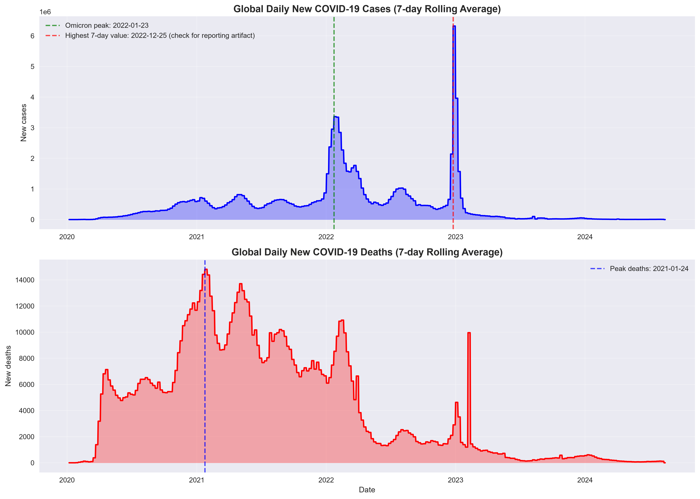
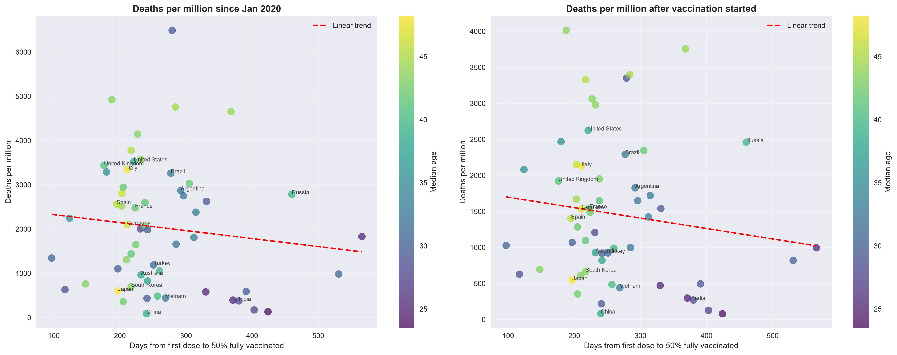

# COVID-19 Global Impact Analysis - Executive Summary

Source: Our World in Data (to 14 Aug 2024) | 237 countries | Prepared by Archana, Data Analytics Intern | 15 Oct 2026

> **Question: did faster vaccination rollout go with lower death rates?** Across 57 countries (over 1M people and 1M cases) we found **no statistically detectable relationship**: Spearman correlation between days to 50% fully vaccinated and deaths per million = -0.17 (p = 0.20); +0.07 after controlling for median age (p = 0.62). This does not show vaccines were ineffective: cumulative deaths depend heavily on age structure, reporting quality and timing, and country-level data cannot isolate vaccine effects.

## Key findings

- **Deaths per reported case fell sharply.** Global deaths peaked at 14,811/day (2021-01-24); cases peaked at 3.36 million/day during Omicron (2022-01-23). Deaths per 1,000 reported cases fell from 24.5 to 2.5 between the two peaks. This is consistent with vaccination, prior infection and a milder variant, but testing and reporting also changed, so it is descriptive only.
- **Beware reporting artifacts.** The highest 7-day case value (6.3 million/day, Dec 2022) is not a global surge: China accounts for 86% of cases reported in that window, indicating a one-country reporting effect; China is also the largest contributor to the Feb 2023 death spike.
- **Case fatality rates vary widely.** Among 129 countries with over 100K cases, CFR ranges from 0.05% (Brunei) to 4.88% (Peru). Lowest: Brunei, Singapore, Iceland, South Korea, China. Highest: Peru, Egypt, Mexico, Bosnia and Herzegovina, Afghanistan. CFR reflects how many cases were detected, not only how deadly the disease was.
- **Rollout speed differed about eight-fold.** 87 countries (over 1M people) reached 50% fully vaccinated, from 97 days after the first dose (Israel) to 766 (Sierra Leone); median 257. Major countries: UK 176, Germany 211, US 221, France 223, Brazil 277, India 380 days.
- **Regional impact was uneven.** Asia reported 38.9% of cases and Europe 32.6%. Deaths per million: South America 3,104, Europe 2,815, North America 2,784, Oceania 731, Asia 347, Africa 182. Low figures in Asia and Africa likely partly reflect limited testing and reporting.
- **Early spread was fast.** The median doubling time of cumulative cases across countries was 9.6 days in March-April 2020.

## Method and limitations

**Method:** removed aggregates and non-country rows; forward-filled cumulative columns within each country; derived 7-day averages, case fatality rate, vaccination rate, doubling time and days from first dose to 50% fully vaccinated; Spearman correlations with a median-age control.

**Limitations:** underreporting and different testing strategies; one-country batch reporting creates spikes; rollout start is the first dose record in the data; country-level correlation is not causation.

## Next steps

Compare deaths within age bands and matched time windows (for example, deaths per case before and after vaccination in the same country) and use the dataset's excess-mortality columns to reduce reporting bias.
